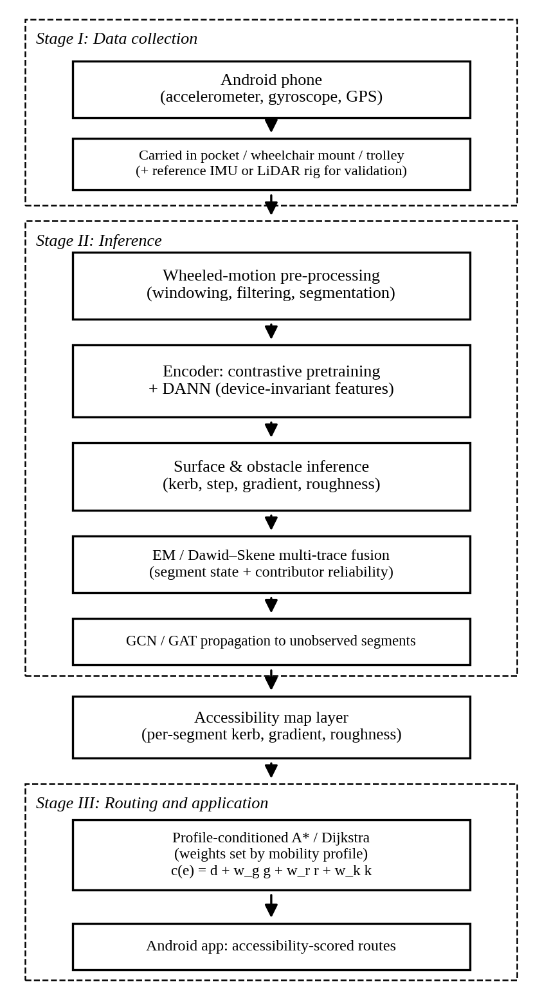

# PathSense

**Inferring pedestrian accessibility from crowdsourced smartphone inertial data** — VIT Vellore (SCOPE) group project.
Domain: Route Finding / Person with Disability.

Phone accelerometer + gyroscope traces → kerbs, gradient and roughness per road segment → probabilistic fusion of many
unreliable traces → graph propagation to segments nobody walked → accessibility-aware routing per mobility profile.

> **Read this first:** the demo and every metric in `outputs/metrics.json` currently come from a **simulator**
> (`pathsense/simulate.py`) because the real pilot data does not exist yet. Simulated numbers are for developing and
> testing the pipeline only. **Never put them in the paper as results.** See `docs/HANDOFF.md` for what is real and what is not.

## Quick start
```bash
python -m venv .venv && source .venv/bin/activate      # Windows: .venv\Scripts\activate
pip install -r requirements.txt
python scripts/fetch_osm.py           # download the REAL campus footpaths from OpenStreetMap -> data/osm_vit.json (needs internet)
python scripts/run_pipeline.py --osm data/osm_vit.json   # real geometry + simulated surface data -> outputs/
# (without --osm the pipeline uses a fake grid: fine for tests, but paths cut through buildings/lake)
python app/server.py                  # demo at http://127.0.0.1:5000  (click start + destination)
python -m pytest -q tests             # 11 tests
```
Deep-learning part (functionalities 3 & 4): `pip install -r requirements-ml.txt && python scripts/train_ssl_dann.py`
(written but **not yet run**, see HANDOFF).

## Pipeline


| # | Functionality | Code | Status |
|---|---|---|---|
| 1 | Inertial surface & obstacle inference | `pathsense/features.py` | works on simulated data, tested |
| 2 | EM / Dawid–Skene trace fusion | `pathsense/fusion.py` | works, tested; **not yet better than majority vote on sim** (open task F2) |
| 3 | Contrastive (SimCLR) pretraining | `pathsense/ml/models.py`, `scripts/train_ssl_dann.py` | written, **never run** |
| 4 | DANN device invariance | same | written, **never run** |
| 5 | GCN propagation to unobserved segments | `pathsense/graph_prop.py` | numpy GCN works, tested; torch/GAT version TODO |
| 6 | Profile-conditioned A* routing | `pathsense/routing.py` | works, tested |
| 7 | Wheeled-motion preprocessing | `pathsense/features.py` (+ `config.py`) | provisional params; needs pilot data |

Demo app: `app/` (Flask + Leaflet). Handoff/plan: `docs/HANDOFF.md`, `docs/ROADMAP.md`. Paper draft: `docs/paper/`.

## Layout
```
pathsense/        library (osm, simulate, features, fusion, graph_prop, routing, ml/)
scripts/          fetch_osm.py, run_pipeline.py, train_ssl_dann.py, create_issues.sh
app/              Flask server + Leaflet front end
tests/            pytest
docs/             HANDOFF.md, ROADMAP.md, DATA_COLLECTION.md, paper/
```
